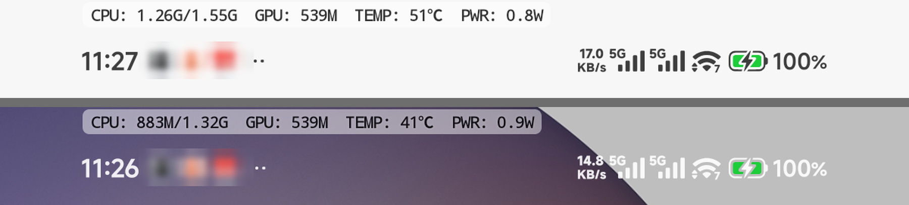

# K90 Pro Max 调频模块（CPU + GPU）


Redmi K90 Pro Max 的 **CPU + GPU** 频率档位管理模块。

### 机型标识

| 项目 | 值 |
|---|---|
| 机型 | Redmi K90 Pro Max |
| 机型代号 | `25102RKBEC`（`ro.product.model`） |
| 设备代号 | `myron`（`ro.product.device`，`customize.sh` 的机型判断用它） |
| SoC | 高通 SM8850 骁龙 8 Elite Gen 5，kernel 6.12 GKI |
| 系统 | Android 16，`BP2A.250605.031.A3` |

九个预设档位覆盖「最低频率 → 全拉满测速」，带本地网页界面：手机浏览器打开 `http://127.0.0.1:8088/` 就能看两簇 CPU 与 GPU 的实时频率、切档、下拉式自定义频率。单文件 HTML，零外部依赖。

---

## 特性

- **9 个档位**：出厂默认 / 最低频率 / 极致省电 / 日常省电 / 日常均衡 / 日常增强 / 轻度游戏 / 重度游戏 / 全拉满测速
- **GPU 联动**：每个档位同时设 CPU 与 GPU 功耗等级（按 `type=gpu` 动态定位冷却设备，18 档 160–1200 MHz）
- **自定义频率**：下拉选择框 + `确认应用`。选完不生效，点确认才一次性原子写入两簇与 GPU；`恢复本档默认` 一键回到预设
- **逐核心开关（限核）**：界面 8 个开关或 `cpuctl core <n> on|off` 单独开关任意核心，守护进程每轮维持；`cpu0` 强制常开（内核其实允许关，但关掉会让调度和温控出错）
- **自动维持守护**：每 10 秒校正一次（`CPUCTL_INTERVAL` 可调），被系统偷偷改回来会拉回去；测速档 5 分钟自动回落到重度游戏
- **温度保护**：CPU 温度达到上限（默认 48 °C）时让权给系统温控
- **实时功耗**：读 `current_now` / `voltage_now` 现算功率，界面显示 W + 电压电流，并用 `status` 区分充电中 / 放电中（内核惯例：负电流=充电）
- **配置备份/还原**：抓取出厂 sysfs 快照，界面按钮、命令行、卸载三个入口都能还原
- **纯 sysfs + KGSL**：只读写 `/sys`，不注入进程、不 hook 内核
- **低开销**：单次状态请求 295 ms（v1.4 为 1.37 s，最初 4 s），前端轮询在页面闲置时自动降频到 6 s / 15 s

---

## 环境

| 项目 | 内容 |
|---|---|
| Root | KernelSU（**临时 root 也能用**，见下文） |
| CPU 集群 | `policy0` = cpu0–5（6 性能核，384 MHz–3.63 GHz）、`policy6` = cpu6–7（2 超大核，768 MHz–4.61 GHz） |
| 调速器 | `walt`（另有 `performance` / `powersave` / `schedutil` / `conservative` / `migov`） |
| GPU | `kgsl-3d0`，18 个功耗等级：0 = 1200 MHz → 17 = 160 MHz |
| GPU 限频点 | `type=gpu` 且 `max_state>1` 的 `cooling_device*`（**编号会变，切勿硬编码**），`cur_state` 即功耗等级 |

---

## 安装

**方式一：管理器刷入**

下载 Release 里的 `K90ProMax-cpuctl-v1.4.1.zip`，在 KernelSU / Magisk 的「模块 → 从本地安装」中选它。

**方式二：命令行**

```bash
adb push K90ProMax-cpuctl-v1.4.1.zip /data/local/tmp/
su -c 'magisk --install-module /data/local/tmp/K90ProMax-cpuctl-v1.4.1.zip'
```

**方式三：不重启立即用（临时 root 场景）**

```bash
adb push K90ProMax-cpuctl-v1.4.1.zip /data/local/tmp/
su -c 'M=/data/adb/modules/k90_cpuctl; rm -rf $M; mkdir -p $M; \
       busybox unzip -o /data/local/tmp/K90ProMax-cpuctl-v1.4.1.zip -d $M >/dev/null; \
       chmod 755 $M/bin/* $M/service.sh $M/action.sh $M/uninstall.sh \
                 $M/webroot/cgi-bin/api.cgi'
su -c '/data/adb/modules/k90_cpuctl/bin/cpuctl boot'
```

自己打包：`./package.sh`，产物在 `dist/`。

---

## 档位

| 键 | 名称 | CPU 0-5 | CPU 6-7 | GPU | 说明 |
|---|---|---|---|---|---|
| `stock` | 出厂默认 | 按快照还原 | 按快照还原 | 按快照还原 | 系统原生调度，不做任何约束 |
| `floor` | 最低频率 | 锁 0.38 GHz | 锁 0.77 GHz | 160 MHz | 全集群 min=max 锁死最低频，只保证系统活着 |
| `eco` | 极致省电 | 0.38–1.11 GHz | 0.77–1.02 GHz | 422 MHz | 屏蔽睿频，续航拉满 |
| `saver` | 日常省电 | 0.38–1.56 GHz | 0.77–1.75 GHz | 539 MHz | 刷视频看小说够用 |
| `balanced` | 日常均衡 | 0.38–2.11 GHz | 0.77–2.44 GHz | 726 MHz | 默认推荐 |
| `boost` | 日常增强 | 0.38–2.75 GHz | 0.77–3.13 GHz | 902 MHz | 应用启动更快 |
| `light` | 轻度游戏 | 0.88–3.19 GHz | 1.02–3.65 GHz | 1050 MHz | 王者/和平类，稳帧优先 |
| `heavy` | 重度游戏 | 1.11–3.51 GHz | 1.38–4.07 GHz | 1200 MHz | 原神/绝区零高画质 |
| `max` | 全拉满测速 | 锁 3.63 GHz | 锁 4.61 GHz | 1200 MHz | `performance` 调速器，**5 分钟自动回落到 `heavy`** |

> `floor` 是 min=max 硬锁，实测守护可长期维持，但切换动画、滑动会有肉眼可见延迟，属于挂机/应急档而非日常档。
> `max` 只适合跑分，持续用发热明显。

---

## 限核（逐核心开关）

限核是独立于档位的第二个维度：切换档位不会改动核心开关，核心开关也不会改动频率档位。

```bash
su -c "sh $C core 7 off"        # 关单个核心
su -c "sh $C core 7 on"         # 开回来
su -c "sh $C cores"             # 看实际在线状态与目标状态
su -c "sh $C cores 11111100"    # 8 位掩码，第 i 位对应 cpu i；这里关掉 cpu6-7
su -c "sh $C cores all"         # 全部开启
```

状态存在 `/data/adb/k90_cpuctl/cores`（8 位掩码），守护进程每轮读一次 8 个 `online` 文件（一次 `awk`，不额外 fork），只在偏离目标时才写。

**关于 `cpu0`**：这台机器的 `cpu0` **有** `online` 节点，实测 `echo 0 > /sys/devices/system/cpu/cpu0/online` 能成功。但关掉之后调度和温控会异常，所以模块在四个层面都锁死了它——`cmd_core` 拒绝、`cmd_cores` 掩码自动纠正、`core_save` 强制第 0 位为 1、`core_enforce` 无条件写 1。界面上对应按钮是禁用的。

**实测行为**：

- 关掉 `cpu6`/`cpu7` 后，`core_ctl`（`enable=1`、`min_cpus=0`）在满载下也**不会**把它们拉回来
- 手动 `echo 1 > cpu7/online` 后，守护进程 5 秒内纠正回 0
- 关核的代价：剩余核心承担同样负载，频率会被顶得更高。重载场景可能反而更耗电，所以适合静态低档位，不适合做动态策略

---

## 重要：平台存在动态频率上限

这是本机最关键的一条限制：

**写入 `scaling_max_freq` 超过平台当前允许的上限时，内核会静默丢弃（不报错）。**

| 场景 | policy0 上限 | policy6 上限 |
|---|---|---|
| 稳态（日常/负载） | 2.22 – 2.88 GHz | 2.22 – 2.88 GHz |
| 亮屏/交互瞬时 | 一度到 3.51 GHz | 一度到 4.07 GHz |
| 厂商标称 | 3.63 GHz | 4.61 GHz |

排除了这些可能：`msm_performance/cpu_max_freq`（只负责压低，写 1 GHz 立刻生效）、`perfmgr/max_freq_limit_level`（无效）、thermal cooling device（`state=0` 已是最宽松）、`cpufreq/boost=1`、抬高 `scaling_min_freq`（同样被钳）。

结论：**CPU 侧有厂商功耗策略层，无法通过 sysfs 突破**。所以：

- 省电/均衡档（上限低于 2.2 GHz）**完全按设定生效**
- 游戏档会把目标值写下去，实际跑到平台当时允许的上限
- 界面显示的是**实时生效值**，与标称值不同属正常现象

GPU 侧不一样，热限频是显式可关的：原厂的 GPU 冷却设备默认 `state=1`（1050 MHz），模块置 0 后 GPU 可满血 1200 MHz，实测稳定不回退。

---

## 使用

| 方式 | 操作 |
|---|---|
| 模块按钮 | 管理器里点本模块「操作」按钮，起服务并拉起浏览器 |
| 终端 | `su -c 'sh /data/adb/modules/k90_cpuctl/bin/cpuctl web open'` |
| 手动 | 浏览器打开 `http://127.0.0.1:8088/`（占用时自动顺延到 8092） |

> 只监听 `127.0.0.1`。电脑上调试用 `adb forward tcp:18090 tcp:8088`。

### 界面

- **顶部**：当前档位、CPU/GPU/电池温度、在线状态
- **三张卡**：性能核 0-5、超大核 6-7、GPU，实时频率 + 区间条 + 当前位置，2 秒刷新
- **档位区**：9 个按钮两列排布，当前档绿色高亮
- **自定义频率**：三组下拉框（两簇上下限 + GPU 上限），选项直接来自 `scaling_available_frequencies` 与 GPU 18 档表
  - 选完**不生效**，出现「有未确认的修改」提示、`确认应用` 按钮点亮
  - 点确认才通过 `cpuctl setall` 一次性写入两簇 + GPU，避免连发三次 `set` 的中间态被守护插队
  - `恢复本档默认` 重新应用当前档位预设；若当前已是「自定义」档，则把下拉框回滚到硬件实际生效值
  - GPU 没动过就不下发，免得把系统温控压下来的等级固化成自定义值
- **高级**：自动维持开关、温度保护上限 35–65 °C、重新备份、恢复出厂默认

### 命令

```bash
C=/data/adb/modules/k90_cpuctl/bin/cpuctl
su -c "sh $C status"                                    # 当前状态
su -c "sh $C list"                                      # 档位表
su -c "sh $C apply heavy"                               # 切档
su -c "sh $C set p0 384000 1900800"                     # 自定义单集群（kHz）
su -c "sh $C setall 691200 1785600 883200 1862400 10"   # 两簇 + GPU 一次写入
su -c "sh $C gpu 3"                                     # GPU 等级 0-17（也可写 902 这样的 MHz）
su -c "sh $C core 7 off"                                # 开关单个核心
su -c "sh $C cores 11111100"                            # 批量限核（8 位掩码）
su -c "sh $C watch on|off|status"                       # 自动维持
su -c "sh $C temp"                                      # 温度
su -c "sh $C power"                                     # 实时功耗
su -c "sh $C backup"                                    # 重新备份
su -c "sh $C restore"                                   # 恢复出厂
su -c "sh $C web start|stop|restart|status|open"
su -c "sh $C boot"                                      # 手动跑一次开机流程
```

---

## 架构

```
浏览器 ──HTTP──> busybox httpd (127.0.0.1:8088)
                    └─ CGI ──> api.cgi ──> bin/cpuctl ──> /sys/.../cpufreq/*
                                                       └→ /sys/class/kgsl/kgsl-3d0
```

```
/
├── module.prop              模块元数据
├── customize.sh             刷入时：机型提示 + 权限修正
├── service.sh               开机自启
├── action.sh                管理器「操作」按钮入口
├── uninstall.sh             卸载：停服务 + 按快照还原
├── httpd.conf               busybox httpd 路由
├── bin/
│   ├── cpuctl               命令行 + 服务生命周期
│   ├── profiles.sh          档位定义表（cpuctl 与 api.cgi 共用）
│   ├── watch_run.sh         独立拉起守护
│   └── web_spawn.sh         独立拉起 httpd
└── webroot/
    ├── index.html           单文件前端
    └── cgi-bin/api.cgi      CGI 接口
```

档位表集中在 `bin/profiles.sh`，格式：

```
键|名称|一句话说明|p0下限|p0上限|p6下限|p6上限|调速器|GPU等级
```

前端按钮、`cpuctl list`、CGI 白名单都从这张表动态生成——**加档位只改这一个文件**。

运行时状态在 `/data/adb/k90_cpuctl/`：`profile`、`watch_enabled`、`web_port`、`temp_limit`、`backup/stock.conf`，`gpu_cdev`（解析出的 GPU 冷却设备路径），温度 zone 缓存 `tz_cpu.list` / `tz_batt.list`，以及档位表缓存 `profiles.json`（删掉都会自动重建）。

---

## 性能与开销

调频模块本身必须是「零感知」的，否则压频率省下来的电会被守护进程自己吃掉。这台机器上一个 `fork` 在内存紧张时要 20 ms，所以脚本里的每次 `$(cat ...)` 都很贵。

| 项 | v1.2 | v1.3 | v1.4 | v1.5 |
|---|---|---|---|---|
| 单次 `action=state` | 4.0 s | 1.4 s | 1.1 s | **295 ms** |
| 每请求 fork 次数 | 200+ | ~20 | ~20 | **2** |
| 守护校正间隔 | 3 s | 10 s | 10 s | 10 s |
| 前端轮询（闲置） | 固定 2 s | 2 s → 6 s → 15 s 自适应 | 同左 | 同左 |
| 页面切到后台 | 继续轮询 | 停止 | 停止 | 停止 |

### v1.5 做了什么

单次 fork 实测 25–30 ms（`date +%s` 单独一次就是 29 ms），所以这一版把「减少 fork 次数」做到底：

| 改动 | 省下的 fork |
|---|---|
| 温度（16 个 zone）、GPU 温度、电池电流/电压/状态全并入主 `awk` | 5 |
| 6 个状态文件改用 shell 内建 `read < file`，不再 `$(cat ...)` | 6 |
| 档位表 JSON 缓存到 `$STATE/profiles.json`，命中时 `read` 读一行 | 2 |
| `$(jstr ...)` 改成赋值风格（`jesc` / `jarrv` 写 `$JSTR` / `$JARR`） | 36 |
| `date +%s` 换成 `awk` 的 `systime()` | 1 |

档位缓存用 `[ profiles.sh -nt profiles.json ]` 判断失效，模块升级时 `customize.sh` 会主动删掉它。

三条原则，改代码时请守住：

1. **一次 `awk` 读多个文件**，不要写 `a=$(cat f1); b=$(cat f2)`，每次都是 fork。
2. **任何「遍历一个目录再挨个读」的循环都要缓存**。96 个 thermal zone 跑一次要几百毫秒。
3. **不要用 `sed` / `tr` 做大字符串处理**，bash/mksh 的 `${var//a/b}` 零 fork。

前端轮询必须尊重三种状态：操作中快速刷新、长时间闲置降频、`document.hidden` 直接停。只写 `setInterval(2000)` 会在慢接口上把请求堆到几十个并发。

---

## HTTP API

`GET /cgi-bin/api.cgi?action=...`

| action | 参数 | 说明 |
|---|---|---|
| `state` | — | 档位、温度、实时功耗 `power`、守护状态、两簇与 GPU 详情、8 核在线状态 `cores`、档位表 |
| `apply` | `profile=<键>` | 切档，键来自 `profiles.sh` |
| `set` | `cluster=p0\|p6`、`min`、`max` | 自定义单簇 |
| `setall` | `p0min`、`p0max`、`p6min`、`p6max`、`gpu`(可选) | 原子写入多目标 |
| `gpu` | `level=0..17` | GPU 功耗等级 |
| `core` | `cpu=0..7`、`value=0\|1` | 开关单个核心（`cpu=0` 且 `value=0` 会被拒绝） |
| `cores` | `mask=8位0/1` | 批量限核，第 i 位对应 cpu i |
| `watch` | `value=0\|1` | 开关守护 |
| `temp_limit` | `value=35000..65000` | 温度上限（毫摄氏度） |
| `restore` | — | 恢复出厂快照 |

参数走白名单与纯数字校验，没有 `eval`，非法输入返回 `{"ok":false}`。

---

## 备份与还原

| 位置 | 路径 |
|---|---|
| 设备内 | `/data/adb/k90_cpuctl/backup/stock.conf` |

快照内容：两簇的调速器与上下限、GPU 的 `min/max_pwrlevel`、`pwrscale`、`force_clk_on`、`thermal_pwrlevel`、`cdev_gpu` / `cdev_kgsl` 的 `cur_state`（按 `type` 记录，不记编号）、`msm_performance` 限制值、`cpufreq/boost`。

三种还原方式：

```bash
su -c "sh /data/adb/modules/k90_cpuctl/bin/cpuctl restore"   # 命令行
# 界面 -> 高级 -> 恢复出厂默认（有二次确认）
# 卸载模块时 uninstall.sh 自动读快照写回
```

重新抓基线：**先切到「出厂默认」再 `backup`**，否则会把当前调节值当成基线存进去。

---

## 临时 root 注意事项

当前 root 可能是临时的，重启后丢失：

- 模块**不会**开机自启，开机后频率自动回到出厂状态（这本身也是安全的）
- 重新拿到 root 后跑一次 `su -c 'sh /data/adb/modules/k90_cpuctl/bin/cpuctl boot'`，恢复上次档位、守护与界面
- `/data/adb` 下的文件与备份持久化，重启不丢

换成持久 root 后，`service.sh` 会自动接管开机自启（等 `boot_completed` 再等 20 秒，避开 perf HAL 初始化）。

---

## 改代码前必读（都是踩过的坑）

| 问题 | 原因 | 处理 |
|---|---|---|
| 所有 CGI 返回 401 | busybox httpd 配置要用**空格**分隔，写成冒号会被当「地址 用户名 密码」认证规则 | `httpd.conf` 写 `/cgi-bin *.cgi /system/bin/sh` |
| 点了按钮有反馈但不切换 | 前端请求少了 `action=` 前缀，落到「读取状态」分支 | `api("action="+q)` |
| 滑块误触改频率 | `input[type=range]` 在移动端抢手势 | 自定义面板整体换成 `<select>`，值不变不下发 |
| 切档后某簇没变 | 守护在「写频率」与「写档位」之间用旧档位覆盖一次 | 先写 `profile` 再写频率 |
| 出现 min=max 的异常档 | 撞上系统 boost，min 被抬到 max | 写入后校验并重试 |
| 守护自我复制 | `mksh` 遇到函数体内 `&` 会把调用上下文 fork 成子 shell | 后台启动挪到 `web_spawn.sh` / `watch_run.sh`，`mkdir` 原子锁保单实例 |
| `setsid` 留空壳进程 | toybox 的 `setsid` 不支持 `-f` | 改 `nohup` |
| 读 `max_clock_mhz` 偶发 Permission denied | 与写入同一时刻竞争 | 重试即可，无实际影响 |
| `adb forward` 突然失效 | adb server 被重启，转发规则丢失 | 重新 `adb forward` |
| GPU 档位写进去没反应，`cur_state` 一直是 0 | **`cooling_device` 编号每次启动都会变**：某次开机后 `cooling_device37` 变成了 `cdsp_hw`（`max_state=1`），真正的 `gpu` 落到 `35`；写 11 被静默丢弃 | `cpuctl` 里 `resolve_gpu_cdev` 按 `type` 扫出 `max_state>1` 的 `gpu`/`kgsl` 设备，结果缓存到 `$STATE/gpu_cdev`，`api.cgi` 直接读缓存（零 fork） |
| 换机后 GPU 完全不可控 | 同上，硬编码路径换了机器必然失效 | 同上；若两个设备都在，先给 `kgsl` 写 0 放开，再给 `gpu` 写档位 |
| 待机也耗电、内核态跑满一个核 | **内存耗尽（15 G 只剩 142 MB，swap 8.7 G）时 fork 从 2 ms 涨到 20 ms**；CGI 单请求 fork 上百次 → 一次 `state` 要 4 s，而前端每 2 s 轮询一次，请求无限堆积 | `api.cgi` 合并 sysfs 读取、缓存 thermal zone 列表、`jstr` 改纯 shell 替换；前端轮询自适应 |
| CGI 特别慢 | `cpu_temp()` 遍历 96 个 `thermal_zone`，每个读 `type`+`temp` 两次 = 192 次 fork | 首次运行缓存 zone 路径到 `$STATE/tz_*.list`，之后一次 `awk` 读完 |
| 一条 `printf` 发 30 个参数 | 每个 `$(get ...)` 都是一次 fork | 一次 `awk` 批量读 15 个标量，`while IFS='\|' read` 分发到变量 |
| `awk` 里路径正则全部不命中，温度静默变 0 | **busybox awk 的正则字面量 `/.../` 遇到 `/` 会提前终止**，写 `\/` 不生效，写 `[/]` 直接报 `nonterminated character class` | 路径一律用字符串正则：`FILENAME ~ "thermal_zone[0-9]+/temp$"` |
| 同上，但正则明明能命中 | 温度列表 `tz_cpu.list` 存的是 **zone 目录**，传给 awk 前忘了补 `/temp`；awk 打开目录不报错，规则自然一个都不匹配 | 拼接时写 `$p/temp`；调试时打印 `FILENAME in 数组` 的命中数 |
| 纯 shell 函数仍然很慢 | `$(jstr "$x")` 的函数体虽然零 fork，但**命令替换本身要 fork 子 shell** | 改成赋值风格（`jesc` 写 `$JSTR`），直接引用变量 |

---

## 适配其他机型

1. `bin/profiles.sh` 的频点与 GPU 等级
2. `bin/cpuctl` 顶部的 `policy*` 路径、KGSL 节点路径、温度聚合方式
3. `uninstall.sh` 的出厂还原项

界面与 CGI 都是动态读表，一般不需求改。

---

## 状态栏 HUD（v1.6.0 新增）

两条通道可以同时用，也可以只用其中一条：

| 通道 | 形态 | 开关 |
|---|---|---|
| **通知** | 常驻通知，展开看三行明细 | `cpuctl hud on` / `hud notify on` |
| **悬浮窗** | 状态栏那一行贴一行小字，任意位置 | 模块自带 APK，`service.sh` 开机自动拉起 |



上图上半是白底 App（黑字贴白底，底衬自动隐形），下半是深色桌面（半透明白底衬托住黑字）。
截图时插着充电器且电量 100%，电池侧电流为 0，所以 `PWR` 显示 `0mW` —— 这是真实值，拔掉充电器就会看到实际功耗。

显示内容：

```
CPU: 883M/1.55G  GPU: 539M  TEMP: 41℃  PWR: 0.9W
     │            │         │         └─ 整机功耗（电池 current × voltage）
     │            │         │            默认显示"耗电"；充电时后面加 "+"，如 PWR: 5.8W+
     │            │         └─────────── CPU 最高温（21 个 cpu* zone 取最大）
     │            └───────────────────── GPU 频率（kgsl clock_mhz）
     └────────────────────────────────── 性能核 cpu0-5 / 超大核 cpu6-7
```

默认 **5 秒**刷新（`cpuctl hud interval <1-60>` 可改），频率/GPU 取 5 次采样的**中位数**平滑，
温度/功耗取最新值（它们变得慢，平滑会滞后）。

### 怎么让文字落在状态栏那一行

通知图标只能排左上角，而且 `cmd notification post -i file://...png` 指定的自定义图标
在 MIUI 上**会被直接忽略**（实测截图确认）。所以要贴在状态栏里只能画悬浮窗。

`overlay/` 是配套的极简 App（`com.langrm.k90hud`，16KB）：

- 不读 sysfs、**不要 root**，只轮询模块写的 `/data/local/tmp/k90_hud.txt`
- 一行 5 个整数 `<性能核kHz> <超大核kHz> <温度m℃> <GPUMHz> <mW>`，排版在 App 侧做
- 位置可调：`echo "48 5" > /data/local/tmp/k90_hud_pos.txt`（单位 dp，2 秒生效）；App 里拖滑块同样有效，两者按"谁更新"决定
- 防烧屏：每 10 分钟随机偏移 ±2px
- 横屏隐藏、息屏不刷新
- 默认**黑字 + 60% 半透明白底衬**：白底 App 上底衬隐形、深色壁纸上托住黑字

不想刷模块、只想要状态栏这行字的话，直接下 Release 里的 `K90HUD-<版本>.apk` 装即可
（APK 的 versionCode 与模块对齐，一眼能看出装的哪版）：

```sh
adb install -r K90HUD-v1.6.5.apk
adb shell appops set com.langrm.k90hud SYSTEM_ALERT_WINDOW allow   # 重装后必须补
adb shell am start-foreground-service -n com.langrm.k90hud/.HudService
```

自己从源码编译（不需要 Gradle）：

```sh
cd overlay && ./build.sh      # aapt2 + javac + d8 + zipalign + apksigner
```

### 开销（50 秒实测，`/proc/<pid>/stat`）

| 进程 | CPU 时间 | 单核占比 |
|---|---|---|
| `hud.sh`（采样守护） | 30ms | **0.06%** |
| `k90hud`（悬浮窗） | 110ms | **0.22%** |

压开销的具体手段：

| 手段 | 做法 | 效果 |
|---|---|---|
| 取值方式 | **不用 awk、不用 cat、不用 `$(...)`**：全部 `read < file` 内建读 + 全局变量 | awk 方案 32ms/轮 → **7ms/轮** |
| 温度源 | 启动时筛一次 `thermal_zone*/type`，只留 `cpu*`，并**剔除 `*trip*`** | 21 个 zone（全机近百个） |
| 分级采样 | 频率 + GPU 每 5s，温度 + 功耗每 10s | 最贵的 21 个 zone 只读一半次数 |
| 显示防抖 | 频率变 <150MHz / 温度 <1℃ / GPU <100MHz / 功耗 <0.5W 就不重画，30s 心跳兜底 | 数字不再跳得晃眼 |
| 息屏 | 只读一个 backlight 文件，读到 0 就 sleep 15s | 息屏零采样 |

### 踩过的坑

| 现象 | 原因 / 解法 |
|---|---|
| 温度长年显示 95℃ | `cpu-hw-trip-0/1` 报的是**硬件跳闸阈值**（固定 95000），不是温度，筛 zone 时要排除 `*trip*` |
| PWR 一直显示 0 / 数值大得离谱 | 两个原因：① 满电充电时 `current_now` 读成 0，本来 `if (mw>0)` 会把整段吞掉（已改为恒显示）；② `µV × µA` 得到的是 **pW**，要 `/1e9` 才是 mW，旧代码 `/1e6` 得 µW 却当 mW 用，**大了 1000 倍** |
| App 里拖滑块不生效 | 原来只要 `/data/local/tmp/k90_hud_pos.txt` 存在就无条件覆盖，App 存的偏好永远读不到。改成比较**文件 mtime** 与 App 保存时的 `savedAt`，谁新用谁（v1.6.3） |
| 刷入新模块包但 App 还是旧的 | `service.sh` 现在比对「已装 `base.apk` 的 md5」与「模块内 `K90HUD.apk` 的 md5」，不一致就自动覆盖安装（v1.6.1 起）。注意 `codePath` 是**目录**，真正要算的是它下面的 `base.apk` |
| 重装 APK 后悬浮窗消失 | `pm install -r` 会把 `SYSTEM_ALERT_WINDOW` 重置成 `ignore`：窗口在（`dumpsys window` 能看到）但 `mAppOpVisibility=false`。必须 `install → 等 1s → appops set → 启动` |
| 通知栏多一条划不掉的"正在其他应用的上层显示内容" | AOSP `AlertWindowNotification`（`pkg=android`，ONGOING）。没有系统开关，只能 `cmd notification snooze`，`hud.sh` 每 50 分钟续期 |
| 守护被强杀后再也起不来 | `hud.lock` 残留导致 `mkdir` 失败即退出。改为先判 pid 存活，死了就清锁 |
| 想跟着系统状态栏图标黑白自动变色 | 做不到。这版 HyperOS 的 `dumpsys` **不输出 `appearance` 字段**，只能靠截屏猜像素（`screencap` 一次 211ms），代价远超收益。已放弃，改用默认黑字 |
| `d8` 编译带内部类的 class 崩 | 本机 `d8 8.2.2` 遇 `InnerClasses` 属性 NPE（JDK 21 也一样）。代码里禁用 lambda / 匿名内部类 |

## 卸载

管理器里删除模块即可。`uninstall.sh` 依次：停守护 → 停界面 → 读快照还原 CPU/GPU → 清理运行状态（**保留备份文件**）。

---

## License

[MIT](LICENSE)
